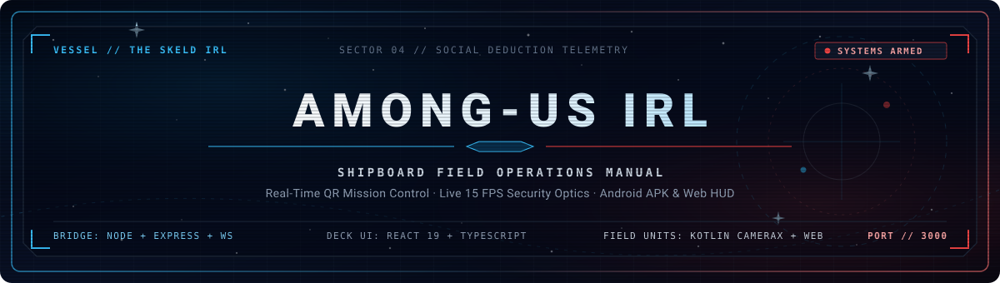
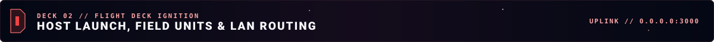
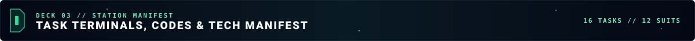

<p align="center">
  
</p>

> **VESSEL LOG // MISSION BRIEFING**
>
> **AMONG-US IRL** converts any house, campus floor, office, or backyard into **The Skeld**. One bridge terminal (**Host PC Mission Control**) coordinates real-time telemetry over WebSockets and outputs physical QR station cards for tasks, crew suit badges, Security Cameras, Reactor Override, and the Emergency Button, while crew members connect via the **Android Companion `.apk`** or **smartphone browser**.

---

<p align="center">
  
</p>

### 1. Bridge Command Center & Print QR Studio

- **Live Mission Uplink**: Displays a real-time **Join Mission QR Code**, auto-detects LAN IPv4 interfaces, accepts custom Port-Forwarded or Tunnel URLs, and serves downloadable **`among-us-irl.apk`** builds from `public-apk/`.
- **Physical Deck Printing (`@media print` + Printable HTML Export)**:
  - **12 Crew Suit Back Badges** *(2 per sheet)* — Oversized back-worn QR codes used for eliminations, forensic scans, Sheriff shots, and body reports.
  - **16 Skeld Task Terminal Cards** *(4 per sheet)* — Custom room-themed physical cards mapped across all Skeld compartments.
  - **Emergency Meeting Terminal (`EMRG`)** — Cafeteria central assembly button.
  - **Reactor Override Terminal (`MELT`)** — Covert sabotage arming plate.
  - **Security Optics Terminal (`CAMS`)** — Live CCTV monitoring station.

### 2. Live 15 FPS Security Optics (`CAMS`)

- During an active mission, alive crew can scan the **Security Camera Terminal QR** (`SKELD|SECURITY|<SESSION>|CAMS` or `CAMS`) to open **Security Monitor** and inspect any alive player's rear camera feed at **15 FPS** *(one active feed per viewer)*.
- **Active Surveillance Telemetry**: Targeted crew devices display a blinking **`SECURITY CAM ACTIVE`** warning banner, Android's system camera indicator, and an active foreground notification inside the `.apk`.
- **Fail-Safe Feed States**:
  - **Comms Signal Jam**: Cuts all feeds immediately to **`SIGNAL JAMMED`**.
  - **QR Scanner Handoff**: Temporarily pauses rear-camera capture (**`SCANNING QR TERMINAL`**) whenever a target opens their QR scanner, then resumes automatically.
  - **Elimination / Offline**: Transitions cleanly to **`SIGNAL LOST — DECEASED`** or disconnects on meetings and mission end.
- **Cross-Client Support**: Operates via **CameraX foreground service** in `android-app/` and **`getUserMedia`** in web browsers, with an **automatic 15 FPS animated test-feed canvas fallback** whenever a browser tab has no hardware camera or runs over plain HTTP for multi-tab local testing.

### 3. Crew Roster & Classified Assignments

| Role | Faction | Field Capability |
| :--- | :--- | :--- |
| **Crewmate** | Crew | Repair assigned ship tasks to reach 100% completion and scan fallen crew to report bodies. |
| **Investigator** | Crew | Scan an alive player's suit QR to inspect their **Suit Color** and **Alignment** (`CREWMATE` or `IMPOSTOR`). |
| **Sheriff** | Crew | Scan an alive player's suit QR to fire; hitting an Impostor/Shapeshifter eliminates them, while firing on an innocent Crewmate eliminates the Sheriff. |
| **Guardian Angel** | Crew | Project a temporary protective shield onto any player (including Impostors) and continue shielding after death as a Ghost. |
| **Jester** | Rogue | Secures an immediate solo victory if ejected by crew vote during a meeting. |
| **Impostor** | Syndicate | Eliminate Crewmates by scanning their suit back QR and trigger shipwide sabotages from the covert Terminal. |
| **Shapeshifter** | Syndicate | Active automatically in 2-Impostor configurations; registers falsely as **`CREWMATE`** to Investigator scans. |

> [!NOTE]
> **Stealth HUD & Briefing Sequence**: At launch, every device plays **`SHHHHH!` -> Role Reveal** once, then collapses into an identical **Plain Crewmate Stealth HUD** (`Scan QR` + privacy-locked `Terminal`) so nearby players cannot shoulder-surf classified roles.

### 4. Shipwide Sabotage Systems

- **Power Blackout (`BLACKOUT`)**: Shuts down regular task terminals across the ship. **Any alive player**—even if Fix Wiring is already complete or unassigned—can scan **`WIR1`** to restore ship power.
- **Comms Signal Jam (`SIGNAL_JAM`, 60s)**: Cuts **Emergency Meetings (`EMRG`)** and scrambles **Security Cameras (`CAMS`)** for 60 seconds.
- **Reactor Meltdown (`REACTOR` / `MELT`)**: Impostors scan the physical **Reactor Override** QR to covertly arm a remote trigger, relocate away from Reactor, and trigger or cancel the meltdown remotely from their **Terminal**. Crewmates must hold the Reactor stabilizer before countdown zero.

### 5. Interactive Tasks, Meetings & Persistence

- **16 Touch-First Skeld Tasks** across `COMMON`, `SHORT`, and `LONG` tiers with visual task feedback.
- **Dead Body & Emergency Protocol**: Scanning a fallen suit QR raises a **Call Emergency Meeting** prompt; meetings advance through **Gathering (`HERE!`) -> Discussion (unanimous `Vote Now` skip) -> Voting (`Skip Vote` + live voter icons) -> Ejection Verdict** showing full vote attribution.
- **Session Persistence**: Connects to MongoDB when `MONGODB_URI` is provided, or persists active mission state automatically to `.skeld-data/sessions.json`.

---

<p align="center">
  
</p>

### Bridge Requirements

- **Node.js** `v20.19+` or `v22.12+` *(recommended: `v22 LTS`)* and **npm**
- **MongoDB** *(Optional)* — Local `mongod` (`mongodb://127.0.0.1:27017`) or MongoDB Atlas. Leave blank to use automatic local file storage (`.skeld-data/sessions.json`).

### 1. Initialize Bridge Systems

```bash
git clone https://github.com/<your-username>/among-us-irl.git
cd among-us-irl
npm install
cp .env.example .env
```

```env
# Optional: MongoDB connection string (local or MongoDB Atlas)
# Leave blank for automatic local persistent storage (.skeld-data/sessions.json)
MONGODB_URI=mongodb://127.0.0.1:27017
MONGODB_DB_NAME=skeld_irl

# Optional: Public URL used when generating the Join Mission QR code
APP_URL=

# Server port (defaults to 3000)
PORT=3000
```

### 2. Ignite Bridge Server

```bash
# Development mode (Express + WebSockets + Vite middleware on port 3000)
npm run dev

# Production build & launch
npm run build
NODE_ENV=production npm start
```

Open **`http://localhost:3000`** on the Host PC to initialize **Mission Control**.

> [!WARNING]
> **Windows Deck Diagnostics**:
> - **`'tsx' is not recognized`**: Run `npm install` in the repository root first, or invoke `npx tsx server.ts`.
> - **`Cannot find native binding` / `@rolldown/binding-win32-x64-msvc`**: Upgrade Node.js to **v22 LTS** (`>=22.12.0` or `>=20.19.0`), remove `node_modules` and `package-lock.json`, and run `npm install` again (or `npm install --no-save @rolldown/binding-win32-x64-msvc`).

### 3. Field Client Units & Airlock Rejoin Protocols

| Field Unit | Directory | Ideal Use Case | Airlock / Exit Behavior |
| :--- | :--- | :--- | :--- |
| **Android Companion `.apk`** | [`android-app/`](./android-app/README.md) | Live IRL matches over plain `http://192.168.x.x:3000` LAN Wi-Fi with CameraX + ML Kit scanning and background 15 FPS Security Cam Service. | Auto-rejoins active matches on relaunch. **Change Host** switches servers while keeping saved session data; **Leave Lobby** shows an Airlock confirmation dialog and clears saved auto-rejoin credentials. |
| **Web Browser HUD** | `src/` | Instant join via mobile or multi-tab desktop browser (`jsQR` scanner, photo upload fallback, manual entry, and automatic 15 FPS test-cam canvas fallback). | Persists auto-rejoin tokens in `localStorage` and shows a *Skeld* Airlock confirmation modal from the header **Leave** button across all match phases (plus **Lobby** and **Ended** screens). |

<details>
<summary><strong>Android Companion APK Deployment (`android-app/`)</strong></summary>

1. Build automatically via the GitHub Actions workflow (**Build Android Companion APK**) or locally in Android Studio from `android-app/`.
2. Drop `among-us-irl.apk` into `public-apk/` (or drag-and-drop it into **Mission Control -> Android Companion App**) so crew can scan and install it directly over Wi-Fi.

</details>

### 4. LAN & Remote Tunnel Routing

1. **Same Wi-Fi / LAN**: Start `npm run dev` (binds `0.0.0.0:3000`), select one of the auto-detected **`Use http://192.168.x.x:3000`** endpoints in **Mission Control**, and allow inbound TCP port `3000` in your firewall.
2. **Remote / Tunnel**: Forward port `3000` or launch an HTTPS tunnel (e.g., `npx cloudflared tunnel --url http://localhost:3000`) and paste the public address into **Host Address** on Mission Control.

---

<p align="center">
  
</p>

### Task Terminal Directory

| Station / Task | Compartment | Tier | Visual Indicator | Manual Code |
| :--- | :--- | :--- | :---: | :---: |
| **Fix Wiring** *(also repairs Blackout)* | Electrical | Common | — | `WIR1` |
| **Swipe Card** | Admin | Common | — | `CRD2` |
| **Clear Asteroids** | Weapons | Short | Yes | `AST3` |
| **Upload Data** | Cafeteria / Admin | Short | — | `DAT4` |
| **Fuel Engines** | Storage / Engine | Long | — | `FUL5` |
| **Submit Scan** | MedBay | Short | Yes | `MED6` |
| **Inspect Sample** | MedBay | Long | — | `SMP7` |
| **Prime Shields** | Shields | Short | Yes | `SHD8` |
| **Start Reactor** | Reactor | Long | — | `RCT9` |
| **Unlock Manifolds** | Reactor | Short | — | `MNF1` |
| **Align Engine Output** | Upper Engine | Short | — | `ALN2` |
| **Empty Chute** | O2 / Storage | Short | Yes | `GRB3` |
| **Calibrate Distributor** | Electrical | Short | — | `CAL4` |
| **Divert Power** | Electrical | Short | — | `PWR5` |
| **Clean O2 Filter** | O2 | Short | — | `OXY6` |
| **Chart Course** | Navigation | Short | — | `NAV7` |

### Special Terminals & Crew Suit Codes

| System | Manual Code(s) | Function |
| :--- | :--- | :--- |
| **Emergency Meeting Button** | `EMRG` | Triggers shipwide Cafeteria assembly (disabled during `SIGNAL_JAM`). |
| **Security Monitor (CCTV)** | `CAMS` *(aliases: `SEC1`, `SECCAM`, `SECURITY`)* | Opens live 15 FPS Security Optics terminal for alive crew. |
| **Reactor Meltdown Override** | `MELT` | Arms remote Reactor Meltdown trigger for Impostors. |
| **Crew Suit Back Badges** | `RED`, `BLU`, `GRN`, `PNK`, `ORG`, `YLW`, `BLK`, `WHT`, `PRP`, `BRN`, `CYN`, `LIM` | Targets player for kills, forensic scans, Sheriff shots, shields, and body reports. |

> [!CAUTION]
> **Anti-Remote Kill Mode**: Enabling **Hide Manual Codes (Anti-Remote Kill)** in Mission Control strips manual short codes from printed sheets and disables manual code input on player devices so every action requires a physical QR scan.

### Hardware & Software Manifest

- **Bridge Server**: Node.js, Express, `ws` (WebSockets), `mongodb` driver *(with automatic `.skeld-data/sessions.json` fallback)*
- **Web HUD**: React 19, TypeScript, Tailwind CSS v4, Motion (`motion/react`), Lucide Icons, Web Audio API synthesizer
- **Android `.apk` (`android-app/`)**: Kotlin, Android WebView + JS Bridge, CameraX 1.4, ML Kit Barcode Scanning, Camera Foreground Service
- **QR Engine**: `qrcode`, `jsqr`, and native ML Kit barcode scanning
